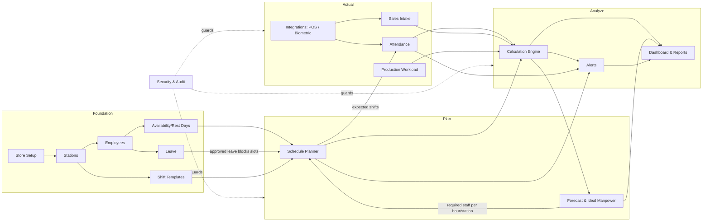

# Cake Shop Store Personnel & Schedule Planner
## Strategic System Plan — Module Integration, Research, Risks & Roadmap

| | |
|---|---|
| **Document type** | Strategic / architecture plan |
| **Platform decision** | Web application (Blazor, .NET 10) — single codebase for store and management |
| **Target** | Single cake shop store (designed to scale to more branches without rework) |
| **Prepared** | 23 November 2026 |
| **Status** | Draft for client review |

---

## Table of Contents

1. Executive Summary
2. Locked-in Decisions
3. Research: What Comparable Systems Do (and What We Borrow)
4. Philippine Compliance Baseline
5. Users, Roles & Scope
6. Module Map (the 16 modules)
7. How the Modules Connect (data flow & integration strategy)
8. Core Data Model
9. Calculation Engine (formulas, corrected and extended)
10. Scheduling Engine
11. Attendance & Timekeeping Engine
12. Forecasting & Ideal Manpower Engine
13. Alerts Engine
14. Dashboard & Reports
15. External Integrations (POS & Biometrics)
16. Security, Permissions & Audit
17. Technical Architecture
18. Problems We Might Encounter (Risk Register)
19. Phased Roadmap
20. Open Questions for the Client
21. Glossary
22. Sources

---

## 1. Executive Summary

The goal is one system that turns **three raw inputs** into **manpower decisions**:

```
  SCHEDULE (who should work)  +  ATTENDANCE (who actually worked)  +  SALES (how busy we were)
                                         │
                                         ▼
          How many people do I need, in which role, at what hour — and am I using them well?
```

Most off-the-shelf tools (7shifts, Deputy, Homebase) do this for restaurants and retail by connecting the schedule, the time clock and the POS. The plan below copies the parts that matter and adds two things that a **cake shop** needs and that generic tools tend to miss:

1. **Role-based workload drivers.** Cashiers scale with transactions, but bakers and decorators scale with *cakes and custom orders*, not with walk-in traffic.
2. **Philippine labor rules built in.** Rest-day rules, meal breaks, overtime and premium categories are flagged in the schedule *before* it is published, not discovered at payroll.

The core design principle: **every module writes facts; only the engines compute.** Nobody types "Transactions per Personnel" into a form. Each KPI is derived from schedule, attendance and sales facts, so numbers always agree across screens and reports.

---

## 2. Locked-in Decisions

| Decision | Choice | Reason |
|---|---|---|
| Platform | Web app (Blazor Web App, .NET 10) | Responsive desktop/tablet/mobile, one codebase, zero install at the store, managers can act from a phone |
| Data access | Dapper + PostgreSQL | Fast, explicit SQL, good for reporting-heavy workloads |
| Code organization | Vertical Slice Architecture | Each feature (e.g. `PublishSchedule`, `ImportSales`) is self-contained and easy to test |
| Multi-store readiness | `StoreId` on every operational table from day one | Single-store UI now, multi-branch later without migration pain |
| Local hardware | Optional small Windows sync agent, only if needed | For biometric devices or POS exports that cannot reach the cloud directly |
| PDF / Excel | QuestPDF + ClosedXML | Both run server-side; QuestPDF Community License is free under USD 1M revenue |

---

## 3. Research: What Comparable Systems Do (and What We Borrow)

### 3.1 Systems reviewed

| System | Known for | What we borrow |
|---|---|---|
| **7shifts** | Restaurant scheduling tied to POS sales | Sales-driven labor forecasting, **Sales per Labor Hour (SPLH)** on the dashboard, labor-vs-sales tracking, overtime alerts before they happen |
| **Deputy** | Demand forecasting & auto-scheduling across retail/hospitality | Demand signals → staffing requirement per period, **skill/role-aware** shift filling, hour/wage budgets with variance tracking |
| **Homebase** | Simple scheduling + time clock for small businesses | Drag-and-drop builder, **templates & schedule duplication**, availability approval, shift swaps/open shifts, **automatic conflict detection**, missed clock-out reminders, **timecard review** before payroll |
| **When I Work / Sling / Connecteam** | Easy staff self-service | Employee mobile view of own schedule, time-off requests without texting the manager |

### 3.2 Key industry concepts

- **Sales per Labor Hour (SPLH)** = total sales ÷ total labor hours worked. A higher SPLH means more revenue per hour paid. This is a better productivity measure than "sales per person" because it accounts for part-timers and short shifts.
- **Demand forecasting**: estimate future customer demand from historical data so you staff for the expected rush and trim slow periods.
- **Labor %**: labor cost ÷ sales. Not in the original prompt, but every comparable system tracks it. Recommended as a Phase 3 feature once wage rates are captured.

### 3.3 Feature benchmark — what the cake shop system will include

| Feature | 7shifts | Deputy | Homebase | **Our system** | Phase |
|---|:-:|:-:|:-:|:-:|:-:|
| Weekly/monthly drag-drop scheduler | ✓ | ✓ | ✓ | ✓ | 1 |
| Shift templates & copy-last-week | ✓ | ✓ | ✓ | ✓ | 1 |
| Conflict / duplicate detection | ✓ | ✓ | ✓ | ✓ | 1 |
| Role/station-based scheduling | ✓ | ✓ | ✓ | ✓ (Production, Decorating, Cashier, Sales) | 1 |
| Labor-law rule checks before publish | ✓ | ✓ | ✓ | ✓ (PH rules) | 1 |
| Availability & leave requests | ✓ | ✓ | ✓ | ✓ | 2 |
| Time clock / attendance | ✓ | ✓ | ✓ | ✓ (manual + import + biometric) | 1–2 |
| Timecard review & approval | ✓ | ✓ | ✓ | ✓ | 2 |
| POS sales import | ✓ | ✓ | ✓ | ✓ (CSV first, API later) | 1 |
| SPLH / transactions per labor hour | ✓ | ✓ | ✓ | ✓ | 1 |
| Demand forecast (hourly) | ✓ | ✓ | ✓ | ✓ (statistical, not AI) | 3 |
| Auto-suggest schedule | ✓ | ✓ | ✓ | ✓ (suggestion, manager approves) | 3 |
| Shift swaps / open shifts | ✓ | ✓ | ✓ | ✓ | 3 |
| Production-driven staffing (cakes/orders) | – | partial | – | ✓ **(cake-shop specific)** | 2 |
| Payroll | add-on | ✓ | ✓ | ✗ **Out of scope** (export timecards only) | – |

**Deliberately excluded:** payroll processing, tip pooling, hiring/onboarding, multi-company HR. These make comparable products heavy and are not what the client asked for.

---

## 4. Philippine Compliance Baseline

The scheduler and attendance engine should **warn** about these rules. It should not compute payroll. Rules must be **configurable**, not hard-coded, because DOLE advisories are issued every year and exemptions depend on establishment size.

| Rule | What the system does |
|---|---|
| **Normal hours**: max 8 hours/day of work, excluding meal break | Shift length validator; anything over 8 worked hours is flagged as overtime |
| **Meal period**: at least 60 minutes, unpaid; short breaks of 5–20 minutes count as paid time | Break rules per shift template; unpaid break deducted from worked hours; short breaks not deducted |
| **Weekly rest day**: at least 24 consecutive hours after every 6 consecutive normal workdays | "Consecutive days worked" counter; publish blocked/warned at day 7 |
| **Overtime**: regular day +25% | OT hours tagged as *Regular-day OT* (for the payroll export) |
| **Rest-day work**: 130% of pay | Work on the employee's scheduled rest day is tagged *Rest-day work* |
| **Holidays**: regular holiday 200%, special non-working 130%, double holiday 300%; premiums stack | Holiday calendar table; hours worked on holidays are tagged by type |
| **Night shift differential**: +10% for 10:00 p.m.–6:00 a.m. | Night hours tagged; NSD flag configurable per store, since retail/service establishments regularly employing ≤5 workers are excluded |
| **Data Privacy Act (RA 10173)** | Employee data is personal information; biometric data is treated as sensitive. Need consent/notice, access controls, retention policy, audit log |

> **Important:** The system *tags hours by category* (regular, OT, rest day, holiday, night). Applying peso rates belongs to payroll. This keeps the scope tight and avoids legal liability for wrong pay computation.

---

## 5. Users, Roles & Scope

### 5.1 Roles

| Role | Typical person | Can do |
|---|---|---|
| **Owner / Admin** | Business owner | Everything; configure benchmarks, stores, users; view all reports |
| **Store Manager** | Branch manager | Manage employees, build & publish schedule, approve leave/timecards, import sales, view analytics |
| **Supervisor / Shift Lead** | OIC on duty | View schedule, record attendance, mark absences, add shift notes; cannot publish or change benchmarks |
| **Staff** | Baker, decorator, cashier, sales | View own schedule, request leave/availability, view own attendance |
| **Auditor (read-only)** | Accountant / HR | Read reports and audit trail only |

### 5.2 Scope boundaries

- **In:** one store's personnel, schedule, attendance, sales summary, analytics, alerts, reports.
- **Ready for:** multiple branches (data model supports it; UI shows a store picker only when more than one store exists).
- **Out:** payroll computation, POS operations, inventory, accounting.

---

## 6. Module Map

| # | Module | Purpose | Owns (writes) | Reads from |
|---|---|---|---|---|
| M01 | **Store Setup** | Store profile, operating hours, business-day cutoff, holidays | Store, OperatingHours, HolidayCalendar | — |
| M02 | **Stations & Positions** | Production, Decorating, Cashiering, Sales; positions within them | Station, Position | M01 |
| M03 | **Employee Masterlist** | Employee records, status, type, skills | Employee, EmployeeStation, EmployeeContact | M01, M02 |
| M04 | **Availability & Rest Days** | Weekly availability, fixed rest days, max hours | Availability, RestDayPattern | M03 |
| M05 | **Leave Management** | Leave requests & approval | LeaveRequest, LeaveBalance | M03 |
| M06 | **Shift Templates** | Opening / Mid / Closing / Full definitions, breaks | ShiftTemplate, BreakRule | M01, M02 |
| M07 | **Schedule Planner** | Weekly/monthly calendar, assignments, publish | Schedule, ScheduleAssignment, ScheduleVersion | M03–M06, M12 |
| M08 | **Attendance & Timekeeping** | Clock-in/out, punches, timecards, approvals | Punch, Timecard, AttendanceException | M07, M15 |
| M09 | **Sales Data Intake** | Import daily + hourly transactions & sales | SalesDaily, SalesHourly, ImportBatch | M01, M15 |
| M10 | **Production Workload** *(cake-shop specific)* | Cakes/orders/custom decorating volume per day | ProductionDaily, CustomOrderLoad | M01 |
| M11 | **Calculation Engine** | All KPIs (TPP, SPP, TPLH, SPLH, utilization, attendance rate) | KpiDaily, KpiHourly (materialized) | M07, M08, M09, M10 |
| M12 | **Forecast & Ideal Manpower** | Hourly demand forecast, required staff per station per hour | Forecast, StaffingRequirement, Benchmark | M09, M10, M11 |
| M13 | **Alerts Engine** | Rule-based alerts & notifications | Alert, AlertRule | M07, M08, M11, M12 |
| M14 | **Dashboard & Reports** | KPI cards, charts, Excel/PDF exports | ReportRun (log only) | M11, M12, M13 |
| M15 | **Integrations** | POS CSV/API, biometric ADMS, sync agent | IntegrationLog, DeviceRegistry | external |
| M16 | **Security & Audit** | Users, roles, permissions, audit trail | User, Role, AuditLog | all |

---

## 7. How the Modules Connect

### 7.1 Big picture data flow



### 7.2 The closed loop (why this is "one system", not 16 screens)

```
 ┌─────────► 1. FORECAST: last N weeks of sales → expected transactions per hour
 │                         │
 │                         ▼
 │           2. REQUIREMENT: per station, per hour → "need 3 cashiers at 4–6 PM"
 │                         │
 │                         ▼
 │           3. SCHEDULE: manager builds/accepts schedule; coverage gaps shown live
 │                         │
 │                         ▼
 │           4. ATTENDANCE: actual punches compared with the schedule
 │                         │
 │                         ▼
 │           5. SALES: actual transactions & sales imported
 │                         │
 │                         ▼
 │           6. ANALYSIS: TPLH, SPLH, utilization, gap; Understaffed / Optimal / Overstaffed
 │                         │
 └──── 7. LEARN: actuals feed the next forecast; recommendations adjust templates
```

### 7.3 Integration strategy between modules

| Principle | How it's applied |
|---|---|
| **Single source of truth per fact** | Each table has exactly one owning module (see §6). Others read, never write. |
| **Engines compute, screens display** | KPIs are never typed in. M11 calculates from facts and stores results in `KpiDaily`/`KpiHourly` for fast dashboards. |
| **Domain events inside one app** | Slices publish in-process events (e.g. `SchedulePublished`, `PunchRecorded`, `SalesImported`, `LeaveApproved`). Handlers recalculate KPIs and evaluate alerts. Use a simple in-process mediator; no message broker needed at this scale. |
| **Idempotent recalculation** | `RecalculateDay(storeId, businessDate)` can be run any number of times with the same result. Every import, edit or approval calls it. Late corrections fix themselves. |
| **Business date, not calendar date** | All facts are keyed by `BusinessDate`, which respects the store's cutoff (e.g. 4:00 a.m.). A closing shift ending at 12:30 a.m. still belongs to the previous business day. |
| **Versioned schedules** | Published schedules are snapshot-versioned. Analytics compare actuals against the *published* version, not later edits. |
| **Status flags on data quality** | Each day carries `DataCompleteness` (Sales ✓/✗, Attendance ✓/✗, Timecards approved ✓/✗). Dashboards show "Provisional" until all are complete. |

### 7.4 Key events and who reacts

| Event | Raised by | Reactions |
|---|---|---|
| `EmployeeDeactivated` | M03 | M07 flags future assignments as orphaned; M13 raises *Uncovered shift* |
| `LeaveApproved` | M05 | M07 marks the slot as Leave and re-checks coverage; M13 raises *Insufficient manpower* if coverage breaks |
| `SchedulePublished` | M07 | Version snapshot; staff notified; M11 sets the scheduled baseline |
| `PunchRecorded` | M08/M15 | Timecard updated; late/OT recalculated; M13 evaluates *Late / Absent / Excessive OT* |
| `SalesImported` | M09 | M11 recalculates the day; M12 updates forecast history; M13 evaluates *High volume + low staff*, *Low productivity* |
| `ProductionLogged` | M10 | M11/M12 recalc production staffing requirement |
| `BenchmarkChanged` | M12 | Requirements recalculated going forward (history keeps the benchmark that applied at the time) |

---

## 8. Core Data Model

> Every operational table includes `StoreId`, `CreatedAt`, `CreatedBy`, `UpdatedAt`, `UpdatedBy`. Use soft-delete or `IsActive` where records are referenced historically.

### 8.1 Foundation

| Table | Key fields |
|---|---|
| `Store` | StoreId, Name, Address, TimeZone (Asia/Manila), BusinessDayCutoff (e.g. 04:00), IsNsdApplicable |
| `OperatingHours` | StoreId, DayOfWeek, OpenTime, CloseTime, EffectiveFrom |
| `HolidayCalendar` | StoreId (nullable = national), Date, Name, HolidayType (Regular / SpecialNonWorking / SpecialWorking) |
| `Station` | StationId, Name (Production / Decorating / Cashier / Sales), WorkloadDriver (Transactions / Units / Orders / Fixed) |
| `Position` | PositionId, StationId, Title (e.g. Head Baker, Cake Decorator, Cashier) |

### 8.2 People

| Table | Key fields |
|---|---|
| `Employee` | EmployeeId, EmployeeCode, FullName, PositionId, Department, EmploymentStatus (Active / Inactive / Resigned / Terminated / On Hold), EmploymentType (Regular / Probationary / Contractual / Part-time / Seasonal), HireDate, MaxHoursPerWeek, MaxHoursPerDay, IsActive |
| `EmployeeStation` | EmployeeId, StationId, IsPrimary, SkillLevel (1–3) — *a decorator can also cover cashier* |
| `EmployeeContact` | EmployeeId, Mobile, Email, EmergencyContact *(restricted access)* |
| `Availability` | EmployeeId, DayOfWeek, AvailableFrom, AvailableTo, Status (Pending / Approved) |
| `RestDayPattern` | EmployeeId, DayOfWeek, EffectiveFrom |
| `LeaveType` | LeaveTypeId, Name (SIL, Sick, Vacation, Maternity, Paternity, Solo Parent, Unpaid…), IsPaid |
| `LeaveRequest` | LeaveRequestId, EmployeeId, LeaveTypeId, DateFrom, DateTo, HalfDay, Status, ApprovedBy |

### 8.3 Scheduling

| Table | Key fields |
|---|---|
| `ShiftTemplate` | ShiftTemplateId, Code (OPEN / MID / CLOSE / FULL), StartTime, EndTime, UnpaidBreakMinutes, PaidBreakMinutes, StationId (nullable) |
| `Schedule` | ScheduleId, StoreId, PeriodStart, PeriodEnd, Status (Draft / Published / Locked), CurrentVersion |
| `ScheduleAssignment` | AssignmentId, ScheduleId, EmployeeId, BusinessDate, AssignmentType (Shift / RestDay / Leave), ShiftTemplateId, StationId, StartAt, EndAt, BreakMinutes, Notes |
| `ScheduleVersion` | ScheduleId, VersionNo, PublishedAt, PublishedBy, SnapshotJson |
| `StaffingRequirement` | StoreId, BusinessDate, HourSlot, StationId, RequiredCount, Source (Forecast / Manual / MinCoverage) |
| `MinCoverageRule` | StoreId, StationId, DayOfWeek, FromTime, ToTime, MinCount *(e.g. ≥1 cashier while open)* |

### 8.4 Actuals

| Table | Key fields |
|---|---|
| `Punch` | PunchId, EmployeeId, PunchAt, PunchType (In / Out / BreakOut / BreakIn), Source (Manual / Biometric / Import), DeviceId, IsVoided |
| `Timecard` | EmployeeId, BusinessDate, ScheduledStart/End, ActualIn/Out, WorkedMinutes, UnpaidBreakMinutes, LateMinutes, UndertimeMinutes, OvertimeMinutes, NightMinutes, DayCategory (Regular / RestDay / RegularHoliday / SpecialHoliday / Double), AttendanceStatus, ApprovalStatus |
| `AttendanceException` | EmployeeId, BusinessDate, Type (MissingOut, NoShow, Unscheduled, EarlyOut…), Resolution |
| `SalesDaily` | StoreId, BusinessDate, TransactionCount, GrossSales, NetSales, Voids, ImportBatchId |
| `SalesHourly` | StoreId, BusinessDate, HourSlot, TransactionCount, NetSales |
| `ProductionDaily` | StoreId, BusinessDate, CakesProduced, CustomOrders, DecoratingUnits, StdMinutesTotal |
| `ImportBatch` | BatchId, Source, FileName, RowCount, Status, ErrorsJson, ImportedBy |

### 8.5 Analytics & governance

| Table | Key fields |
|---|---|
| `Benchmark` | StoreId, StationId, Metric (TxnPerPersonHour, TxnPerPersonDay, UnitsPerPersonHour), TargetValue, TolerancePct, EffectiveFrom |
| `KpiDaily` | StoreId, BusinessDate, all daily KPIs, DataCompleteness, CalculatedAt |
| `KpiHourly` | StoreId, BusinessDate, HourSlot, StationId, Transactions, Sales, PeopleWorking, LaborMinutes, TPLH, Required, Gap |
| `Alert` | AlertId, StoreId, RuleCode, Severity, BusinessDate, EntityRef, Message, Status (Open / Ack / Resolved) |
| `AuditLog` | AuditId, UserId, Action, Entity, EntityId, BeforeJson, AfterJson, At, IpAddress |

---

## 9. Calculation Engine

### 9.1 Base measures (computed per business date, and per hour where noted)

| Measure | Definition |
|---|---|
| **Scheduled Headcount** | Distinct employees with a *Shift* assignment (excludes RestDay and Leave) |
| **Present Headcount** | Distinct employees with at least one valid In punch |
| **Absent** | Scheduled for a shift, no punch, no approved leave, **not** on rest day |
| **On Leave** | Approved leave covering the date |
| **On Rest Day** | Rest day assignment (never counted as absent) |
| **Late** | First In punch > scheduled start + grace minutes (configurable, e.g. 5 min) |
| **Overtime** | Worked minutes beyond 8 h **or** beyond the scheduled end + OT threshold, whichever the store policy uses |
| **Actual Labor Hours** | Σ (Out − In − unpaid breaks) for all present employees |
| **Actual Available Personnel** | Present − (early-outs before the hour in question); for daily view = Present |
| **Active Employees** | Employees with `IsActive = true` on the date |

### 9.2 KPIs from the original spec (kept)

| KPI | Formula | Notes |
|---|---|---|
| Average Transaction Value (ATV) | Sales ÷ Transactions | Show "—" when transactions = 0 |
| Transactions per Personnel (TPP) | Transactions ÷ Present Headcount | Headcount-based; simple and easy to explain |
| Sales per Personnel (SPP) | Sales ÷ Present Headcount | |
| Transactions per Personnel Hour (TPLH) | Transactions ÷ Actual Labor Hours | **Primary productivity metric** (hours-based, fair to part-timers) |
| Attendance Rate | Present ÷ (Scheduled − Approved Leave on the day) | Rest days excluded by definition |
| Ideal Personnel (simple) | CEILING(Transactions ÷ Target TPP) | Kept for the original prompt; labeled *Simple* |

### 9.3 KPIs added from industry research

| KPI | Formula | Why |
|---|---|---|
| **Sales per Labor Hour (SPLH)** | Sales ÷ Actual Labor Hours | Industry standard in 7shifts/Deputy-type dashboards |
| **Schedule Adherence** | Minutes worked within scheduled window ÷ scheduled minutes | Shows whether the schedule is followed, not just whether people showed up |
| **Personnel Utilization** | Required Labor Hours ÷ Actual Labor Hours × 100 | Below ~85% → possibly overstaffed; above ~110% → stretched |
| **Coverage Ratio (hourly)** | People Working ÷ Required, per station per hour | Drives the heatmap |
| **Labor % (Phase 3)** | Labor Cost ÷ Net Sales | Needs wage rates; optional |

### 9.4 Fixing the Ideal Manpower formula

The original formula `CEILING(Daily Transactions / Target)` gives **one headcount for the whole day across all roles**. That conflicts with the prompt's own business rules (separate production, decorating, cashiering and sales; account for hours; don't cut headcount without considering coverage).

**Proposed: station-aware, hour-aware requirement**

```
For each business date d, hour h, station s:

  If s.WorkloadDriver = Transactions  (Cashier, Sales):
      Demand(h)     = ForecastTransactions(d, h)            -- or actual, for after-the-fact analysis
      Workload(h)   = CEILING( Demand(h) / Benchmark[s].TxnPerPersonHour )

  If s.WorkloadDriver = Units / Orders  (Production, Decorating):
      LaborMinutes  = Σ (items × standard minutes per item) for the day
      PeopleNeeded  = CEILING( LaborMinutes / (ProductiveMinutesPerShift × EfficiencyFactor) )
      Spread across the production window (e.g. 5 AM–1 PM) instead of by customer traffic

  If s.WorkloadDriver = Fixed:
      Workload(h)   = configured headcount

  Required(d,h,s) = MAX( Workload(h), MinCoverage(d,h,s) )
```

**Daily Ideal Manpower** = the number of distinct people needed to cover all `Required(d,h,s)` slots using the store's shift templates (a coverage problem, solved greedily in Phase 2 and with a solver later if needed). This answers both "how many people per day" and "how many per shift."

### 9.5 Staffing status classification

| Status | Rule (configurable tolerance, default ±10%) |
|---|---|
| **Understaffed** | Actual < Required in any hour with a coverage ratio < 1.0 **or** daily actual labor hours < required × (1 − tolerance) |
| **Optimal** | Within tolerance and every min-coverage rule satisfied |
| **Potentially Overstaffed** | Actual labor hours > required × (1 + tolerance) **and** removing one person would not break any min-coverage rule or station requirement |

**Safety rule (from the prompt):** the system never says "reduce headcount." It says *"Potentially overstaffed 2–4 PM in Sales; consider shifting one Mid shift to start at 3 PM."* Recommendations move hours; they don't remove people.

### 9.6 Edge cases the engine must handle

- Zero transactions (store closed or sales not imported) → KPIs show "—", not 0 or infinity.
- Zero present staff → no division; raise *Data incomplete* alert.
- Missing clock-out → timecard is *Exception*; it is excluded from labor hours until resolved (with a warning on the dashboard).
- Shift crossing midnight → assigned to the business date via cutoff.
- Employee working two stations in a day → labor minutes split by assignment segments.
- Benchmark changed mid-month → each day uses the benchmark effective on that date.

---

## 10. Scheduling Engine

### 10.1 Workflow

```
Draft ──(manager edits; live validation)──► Review (coverage heatmap, warnings) ──► Publish (version N)
   ▲                                                                                     │
   └──────────────── Edit after publish creates Draft N+1 ◄──────────────────────────────┘
                     (changes highlighted, affected staff notified, audit logged)
```

### 10.2 Validation rules (run live in the editor and again on publish)

| Rule | Severity | Description |
|---|---|---|
| Duplicate assignment | **Block** | Same employee, same date, overlapping time |
| Overlap across stations | **Block** | One person cannot be in Production and Cashier at the same time |
| Inactive employee | **Block** | Cannot schedule deactivated/resigned employees |
| On approved leave | **Block** | Slot already used by leave |
| Outside availability | Warn | Scheduled outside approved availability |
| Rest day conflict | Warn | Scheduled on fixed rest day (allowed, but tagged as rest-day work) |
| 7th consecutive day | Warn (configurable to Block) | Violates the 24h rest after 6 consecutive workdays |
| Daily hours > 8 | Warn | Will generate overtime |
| Weekly hours > employee max | Warn | Over max working hours |
| Clopening | Warn | Closing shift followed by opening shift with < N hours rest (default 10 h) |
| Below min coverage | Warn | Any hour where station headcount < MinCoverage |
| Below requirement | Info/Warn | Coverage ratio < 1.0 vs forecast requirement |
| Skill mismatch | Warn | Assigned to a station not in the employee's `EmployeeStation` |
| Holiday | Info | Date is a holiday; hours will be tagged |

### 10.3 Productivity features (from Homebase/7shifts/Deputy)

- **Templates**: save a "typical week" and apply it.
- **Copy last week / copy same week last month.**
- **Coverage heatmap** under the calendar: hours × stations colored by coverage ratio.
- **Unassigned shifts**: create the shift first, assign a person later (open shifts).
- **Bulk actions**: assign the rest day for everyone for the month, apply a template to a date range.
- **Suggest schedule (Phase 3)**: fills unassigned slots based on requirement, availability, skills, max hours and fairness. The manager reviews and accepts; nothing is auto-published.

---

## 11. Attendance & Timekeeping Engine

### 11.1 Capture methods (in rollout order)

1. **Manual entry** by Supervisor/Manager (MVP; always available as a fallback).
2. **CSV/Excel import** from the existing biometric device software.
3. **Live biometric push** via ZKTeco-style ADMS (devices push punches over HTTP to the server, which works behind a router without a static IP).
4. **Web clock-in kiosk** on a store tablet with PIN (optional; add photo capture only after a privacy review).

### 11.2 Punch → Timecard pipeline

```
Raw punches ──► De-duplicate (same employee within 1 min) ──► Pair In/Out by business date
     ──► Match to scheduled assignment (nearest shift) ──► Compute: worked, late, undertime, OT, night, breaks
     ──► Classify day (regular / rest day / holiday type) ──► Exceptions (missing Out, unscheduled, no-show)
     ──► Supervisor/Manager review ──► Approved timecard ──► KPIs & payroll export
```

### 11.3 Attendance status logic

| Situation | Status |
|---|---|
| Scheduled + punched | Present (Late if after grace) |
| Scheduled + no punch + no leave | **Absent** |
| Scheduled + approved leave | On Leave *(not absent)* |
| Rest day assignment | Rest Day *(not absent, not scheduled headcount)* |
| Not scheduled + punched | Unscheduled Work → needs manager decision |
| In without Out | Missing Punch → exception queue + reminder to the employee |

---

## 12. Forecasting & Ideal Manpower Engine

Start simple and explainable. A store manager must be able to trust the numbers.

### 12.1 Forecast method (Phase 3; manual overrides from Phase 2)

```
ForecastTxn(d, h) = WeightedAverage( SalesHourly for the same weekday & hour, last 4–8 weeks )
                    × SeasonalityFactor (holiday/occasion multiplier, e.g. Valentine's, Mother's Day, Christmas)
                    + ManualAdjustment (manager note: "school event nearby", "promo")
```

- Exclude anomalous days (store closure, power outage) using a flag on the day.
- Cake-shop events are huge: **Valentine's, Mother's Day, Father's Day, graduation season, Christmas, New Year** and big pre-order days. An **Event Calendar** with multipliers matters more than a sophisticated model.
- Production forecast uses **pre-orders already booked**, which are more reliable than statistics.

### 12.2 Outputs

- Required people per **station × hour** for the next 1–4 weeks.
- Required people per **shift** (Opening / Mid / Closing).
- **Peak hours** (top 20% of hourly transactions) and **low-traffic hours** (bottom 20%).
- Recommendations, e.g.:
  - "Saturdays 3–6 PM: average coverage ratio 0.7 for Cashier over the last 4 weeks → add a Mid shift starting at 2 PM."
  - "Tuesdays 9–11 AM: utilization 60% in Sales → move one Opening start to 11 AM."

### 12.3 Benchmark management

- Benchmarks per station (e.g. Cashier: 20 transactions per person-hour; Decorator: 6 custom cakes per person-day).
- **Suggested benchmark**: the system shows the store's own historical median TPLH so the manager sets a realistic target instead of guessing.
- Benchmarks are effective-dated (history is never recomputed with today's target).

---

## 13. Alerts Engine

| Code | Alert | Trigger (default; all configurable) | Severity | Who |
|---|---|---|---|---|
| A01 | Insufficient manpower | Scheduled coverage < requirement or min coverage, for a future date | High | Manager |
| A02 | Uncovered shift | Open/unassigned shift within 48 h, or assignee on leave/deactivated | High | Manager, Supervisor |
| A03 | Employee absence | Scheduled, not clocked in by start + 30 min | Medium | Supervisor, Manager |
| A04 | Late arrival | Late minutes > grace | Low | Supervisor |
| A05 | Excessive overtime | Weekly OT > X hours, or daily worked > 10 h | Medium | Manager |
| A06 | Schedule conflict | Any Block/Warn rule present in a published schedule | Medium | Manager |
| A07 | High volume, low staff | Hourly coverage ratio < 0.8 during an actual peak hour | High | Manager |
| A08 | Low productivity | TPLH < benchmark × (1 − tolerance) for 3+ consecutive days | Low | Manager, Owner |
| A09 | 7th consecutive day | Employee scheduled 7 days in a row | Medium | Manager |
| A10 | Missing punch | In without Out after shift end + 1 h | Medium | Employee, Supervisor |
| A11 | Data incomplete | No sales import by 10 AM for the previous day | Medium | Manager |
| A12 | Pending approvals | Leave/timecards awaiting approval > 24 h | Low | Manager |

**Delivery:** in-app bell plus a dashboard panel (MVP); email (Phase 2); SMS/Viber/Telegram (optional Phase 3). **Alert fatigue control:** de-duplicate per entity per day, group related alerts, use a daily digest for low severity.

---

## 14. Dashboard & Reports

### 14.1 KPI cards (top row)

Total Transactions · Total Sales · ATV · Personnel Scheduled · Personnel Present · Attendance Rate · TPP · SPP · **TPLH** · **SPLH** · Ideal Manpower · Manpower Gap · Utilization % · Staffing Status badge (Understaffed / Optimal / Overstaffed)

Each card shows **today vs. same weekday average** and a "Provisional" badge if data is incomplete.

### 14.2 Charts

| Chart | Type |
|---|---|
| Daily Transactions vs. Personnel | Bars (transactions) + line (present headcount), dual axis |
| Daily Sales vs. Manpower | Bars (sales) + line (labor hours) |
| Weekly Productivity Trend | Line: TPLH & SPLH by day, benchmark reference line |
| Monthly Personnel Utilization | Bars by day colored by status |
| Scheduled vs. Actual Personnel | Grouped bars per day |
| **Peak Hour Heatmap** | Weekday × hour, colored by avg transactions |
| **Coverage Heatmap** | Hour × station, colored by coverage ratio (the most actionable view) |
| Attendance breakdown | Stacked bars: present, late, absent, leave, rest day |

**Filters:** Daily / Weekly / Monthly / Custom range; Station; Employment type; (Store, when more than one).

### 14.3 Reports (Excel via ClosedXML, PDF via QuestPDF)

| Report | Content |
|---|---|
| Daily Personnel Attendance | Per employee: scheduled, in/out, late, OT, status |
| Weekly / Monthly Employee Schedule | Calendar grid, printable for the staff board |
| Daily Transactions vs. Personnel | Daily KPIs table |
| Weekly Manpower Productivity | TPLH/SPLH by day & station vs. benchmark |
| Monthly Manpower Analysis | Utilization, gaps, OT hours, attendance rate trends |
| Ideal vs. Actual Personnel | Per day & per station, with status |
| Peak Hours Analysis | Hourly table + heatmap + recommendations |
| **Timecard export (added)** | Hours tagged by category for the payroll provider |
| **Audit report (added)** | Schedule changes with who, when, before/after |

Heavy reports (monthly, multi-month) run as background jobs and appear in a "My Reports" list when ready.

---

## 15. External Integrations

### 15.1 POS sales data

| Option | Effort | Notes |
|---|---|---|
| **A. CSV/Excel upload** (MVP) | Low | A mapping wizard (choose the date, time, txn count, amount columns) saved per POS format; validates duplicates and totals |
| **B. Watched-folder agent** | Medium | Small Windows service at the store picks up the POS's daily export and uploads it automatically |
| **C. Direct API** | Varies | Only if the POS vendor exposes one |
| **D. Your own WPF POS** | Low (if applicable) | If the client uses the POS you build, push `SalesHourly` directly to the API |

**Minimum data needed:** business date, hour, transaction count, net sales. Line-item detail is *not* needed.

### 15.2 Biometric attendance

- Many PH stores use ZKTeco-family devices. These support the **ADMS push protocol**: the device posts attendance logs over HTTP to `/iclock/cdata` on your server, so it works behind a router without polling.
- Implementation: an ASP.NET Core endpoint that handles the handshake, receives `ATTLOG` records, maps the device user ID to `EmployeeId`, and writes `Punch` rows (idempotent by device serial + user + timestamp).
- Fallback: CSV export from the device software → import.
- **Privacy:** store only punch logs in the app, never fingerprint/face templates (those stay on the device).

---

## 16. Security, Permissions & Audit

### 16.1 Permission matrix (excerpt)

| Capability | Owner | Manager | Supervisor | Staff | Auditor |
|---|:-:|:-:|:-:|:-:|:-:|
| Configure store, benchmarks, roles | ✓ | – | – | – | – |
| Manage employees | ✓ | ✓ | view | own | view |
| Build/publish schedule | ✓ | ✓ | view | own | view |
| Record attendance | ✓ | ✓ | ✓ | own clock | view |
| Approve timecards/leave | ✓ | ✓ | – | – | – |
| Import sales | ✓ | ✓ | – | – | – |
| View analytics & reports | ✓ | ✓ | limited | – | ✓ |
| View audit log | ✓ | ✓ | – | – | ✓ |
| View contact/emergency info | ✓ | ✓ | – | own | – |

### 16.2 Security measures

- ASP.NET Core Identity; strong passwords; lockout; optional 2FA for Owner/Manager.
- Policy-based authorization **enforced in every slice handler**, not just hidden UI.
- Every query filtered by `StoreId` the user is allowed to see.
- HTTPS only; secure cookies; anti-forgery tokens.
- **Audit trail**: every create/update/delete on schedules, assignments, timecards, leave, benchmarks and employees writes `AuditLog` with before/after JSON.
- Backups: daily automated DB backup + monthly restore test.
- Data Privacy Act: privacy notice to employees, purpose limitation, retention policy (e.g. keep attendance 3 years, then archive), and data-subject access on request.

---

## 17. Technical Architecture

### 17.1 Stack

| Layer | Choice |
|---|---|
| UI | Blazor Web App (.NET 10), Interactive Server for manager screens; staff self-service pages kept lightweight for mobile |
| Component library | Radzen Blazor (Scheduler, DataGrid, Charts) *or* MudBlazor + a scheduler component — choose one and stay consistent |
| API surface | Minimal APIs (used by the sync agent, ADMS endpoint, future mobile) |
| Data | PostgreSQL + Dapper; migrations with DbUp or FluentMigrator |
| Background jobs | `BackgroundService` + `PeriodicTimer` for MVP (nightly KPI recalc, alert scans, reminders); move to Hangfire/Quartz if job count grows |
| Real-time | Blazor Server circuit/SignalR for live alert badges and coverage updates |
| Reporting | QuestPDF (PDF), ClosedXML (Excel) |
| Logging | Serilog → file/DB; health checks endpoint |
| Hosting | Windows or Linux host supporting .NET 10 + PostgreSQL; check connection-limit constraints of shared hosting before choosing |

### 17.2 Solution layout (Vertical Slice)

```
CakeShopWfm.sln
├─ src/
│  ├─ CakeShopWfm.Web/                  # Blazor app + Minimal APIs
│  │  ├─ Features/
│  │  │  ├─ Employees/   (CreateEmployee, EditEmployee, Deactivate, Search)
│  │  │  ├─ Scheduling/  (CreateShift, MoveShift, ApplyTemplate, ValidateSchedule, PublishSchedule)
│  │  │  ├─ Leave/       (RequestLeave, ApproveLeave)
│  │  │  ├─ Attendance/  (RecordPunch, ImportPunches, BuildTimecards, ApproveTimecard)
│  │  │  ├─ Sales/       (ImportSalesCsv, MapColumns)
│  │  │  ├─ Production/  (LogProduction)
│  │  │  ├─ Analytics/   (RecalculateDay, GetDashboard, GetHeatmap)
│  │  │  ├─ Forecast/    (BuildForecast, BuildRequirements, SuggestSchedule)
│  │  │  ├─ Alerts/      (EvaluateRules, AcknowledgeAlert)
│  │  │  ├─ Reports/     (Export*)
│  │  │  └─ Integrations/(AdmsEndpoint, AgentUpload)
│  │  ├─ Shared/ (Auth, Audit, StoreContext, BusinessDate, Results)
│  │  └─ Components/ (Layout, KpiCard, CoverageHeatmap…)
│  ├─ CakeShopWfm.Domain/               # pure calculation logic (no DB) — easiest to unit test
│  └─ CakeShopWfm.SyncAgent/            # optional Windows service
└─ tests/
   ├─ CakeShopWfm.Domain.Tests/         # formulas, timecard pairing, rules
   └─ CakeShopWfm.Integration.Tests/    # Testcontainers PostgreSQL
```

**Key design rule:** all formulas (§9), timecard logic (§11) and schedule rules (§10.2) live in the **Domain** project as pure functions with unit tests. Slices load data, call the domain, and save results.

### 17.3 Performance notes

- Store KPIs in `KpiDaily`/`KpiHourly`; dashboards read precomputed rows (fast even on cheap hosting).
- Index: `(StoreId, BusinessDate)` on every fact table; `(EmployeeId, BusinessDate)` on assignments/timecards/punches.
- Use one connection per request and short transactions, because shared hosts often cap concurrent DB connections.

---

## 18. Problems We Might Encounter (Risk Register)

### 18.1 Data problems

| # | Problem | Impact | Mitigation |
|---|---|---|---|
| D1 | POS can't export **hourly** data, only daily totals | Peak-hour analysis impossible | Confirm early; fall back to daily-only analytics; ask the POS vendor for an hourly Z-reading or a transaction-level export to aggregate |
| D2 | Sales imported late or not at all | KPIs wrong/blank | `DataCompleteness` flag, "Provisional" badge, A11 alert |
| D3 | Duplicate imports | Inflated sales | Unique key (StoreId, BusinessDate, HourSlot); preview & confirm before commit |
| D4 | Missing clock-outs | Labor hours undercounted | Exception queue; reminders; exclude until resolved |
| D5 | Biometric user IDs don't match employee codes | Punches unassigned | Mapping table + "unmatched punches" screen |
| D6 | Device clock drift / wrong time zone | Late/OT miscalculated | Sync device time; store UTC + store time zone; warn when the device time deviates |
| D7 | Shifts crossing midnight | Hours land on the wrong day | Business-day cutoff (§7.3) |
| D8 | Transactions definition differs (voids, refunds, online orders, pre-order pickups) | Inconsistent TPP | Define "transaction" with the client in writing; store net and void counts separately |
| D9 | Pre-orders paid days earlier but picked up today | Workload ≠ sales on the same day | Track production by **pickup/production date** in M10, separate from sales |
| D10 | Sample/demo data mixed with real data | Wrong decisions (explicitly forbidden in the prompt) | Separate demo store or `IsSample` flag excluded from all analytics |

### 18.2 Business-logic problems

| # | Problem | Impact | Mitigation |
|---|---|---|---|
| B1 | One-number "Ideal Personnel" ignores roles | Bad advice (e.g. cut a baker because walk-ins were low) | Station-aware requirements (§9.4) |
| B2 | Benchmark set unrealistically | Everyone looks overstaffed/understaffed | Suggested benchmark from the store's own history; tolerance band |
| B3 | Staff covering multiple roles | Double counting or under counting | Assignment-level station; labor minutes split by segment |
| B4 | Holidays/occasions (Valentine's, Christmas) distort averages | Forecast wrong for normal days and for events | Event calendar; exclude/flag anomalies |
| B5 | "Overstaffed" label demotivates or leads to cuts | Morale/legal issues | Wording "Potentially"; recommendations shift hours, never remove people; min coverage guard |
| B6 | Production work happens before opening hours | Production looks unproductive vs. transactions | Production measured by units/orders, not transactions |
| B7 | Breaks not taken or not recorded | Worked hours inflated | Default break deduction from template + override |
| B8 | Policy differences (grace period, OT approval) | Disputes | All policies configurable and shown on the timecard |

### 18.3 Technical problems

| # | Problem | Impact | Mitigation |
|---|---|---|---|
| T1 | Shared hosting DB connection limits | Errors under load | Pooled short connections; precomputed KPIs; avoid long Blazor-held connections |
| T2 | Blazor Server needs a stable connection; store Wi-Fi drops | Lost edits | Auto-reconnect UI; save drafts per action (not per page); keep clock-in pages simple |
| T3 | Scheduler component performance with month view × many staff | Laggy UI | Virtualization; load by week; month view read-only summary |
| T4 | Recalculation storms (many punches/imports) | CPU spikes | Debounce: queue `RecalculateDay` per date; run once per batch |
| T5 | Time zone bugs | Wrong dates | Single `BusinessDate` helper used everywhere; tests around midnight and the cutoff |
| T6 | Report generation timeouts | Failed exports | Background jobs + download list |
| T7 | Library licensing changes | Legal/cost surprise | Track licenses (QuestPDF thresholds, component libraries) in a LICENSES.md |
| T8 | ADMS device compatibility differs by firmware | Push not working | Pilot with the client's exact device; keep CSV import as a fallback |

### 18.4 People & adoption problems

| # | Problem | Impact | Mitigation |
|---|---|---|---|
| P1 | Manager keeps using the paper/Excel schedule | System data incomplete | Import an existing Excel schedule; make printing the weekly schedule easy |
| P2 | Staff don't have smartphones / data | Self-service unused | Printable schedule; kiosk tablet in the store |
| P3 | Supervisors forget to record attendance | Gaps | Biometric integration; missing-punch alerts |
| P4 | Alert fatigue | Alerts ignored | Severity tiers, digests, de-duplication |
| P5 | Distrust of numbers | Low adoption | Show formulas on hover ("How is this calculated?"); drill down to the raw rows |

### 18.5 Legal & privacy problems

| # | Problem | Impact | Mitigation |
|---|---|---|---|
| L1 | Biometric data under the Data Privacy Act | Compliance risk | Keep templates on the device; privacy notice; access controls; retention policy |
| L2 | Labor rule changes / yearly holiday proclamations | Wrong tags | Configurable rules & holiday table updated yearly |
| L3 | Using the system's tags as payroll truth | Liability | Label as "for payroll reference"; payroll provider computes pay |

---

## 19. Phased Roadmap

Estimates assume one developer; adjust to your capacity.

### Phase 1 — MVP: "Plan & Measure" (≈ 8 weeks)

| Week | Deliverable |
|---|---|
| 1 | Solution scaffold, auth & roles, Store setup, Stations, audit infrastructure, BusinessDate helper |
| 2 | Employee masterlist (CRUD, search, deactivate), rest-day patterns, shift templates |
| 3–4 | Schedule planner: weekly/monthly calendar, assignments, validation rules (§10.2), publish & versioning, print |
| 5 | Attendance: manual punches, timecard builder, late/absent/OT, exception queue |
| 6 | Sales CSV import with mapping & validation; production daily log (simple) |
| 7 | Calculation engine (§9.1–9.3), dashboard KPI cards + 4 core charts, staffing status (simple formula + station-level for cashiers) |
| 8 | Core alerts (A01–A06, A10, A11), 4 reports (Attendance, Weekly Schedule, Daily Txn vs Personnel, Ideal vs Actual), UAT & go-live |

**MVP answers questions 1, 3, 4, 6 and 7 of the expected outcome.**

### Phase 2 — "Coverage" (≈ 4–6 weeks)

Leave management & approvals, availability, min-coverage rules, **station-aware hourly requirements**, coverage heatmap, peak-hours analysis, timecard approval, biometric CSV import → ADMS push, email alerts, the remaining reports, staff self-service view.

**Adds answers to questions 2 and 5.**

### Phase 3 — "Optimize" (≈ 4–6 weeks)

Hourly forecast with event calendar, schedule suggestions, shift-adjustment recommendations, open shifts/swaps, labor cost % (if wages captured), benchmark suggestions, sync agent for POS folder, multi-store UI if needed.

**Adds the answer to question 8 (what schedule adjustments improve productivity).**

---

## 20. Open Questions for the Client

1. **POS:** Which POS is used? Can it export **hourly** transaction counts and sales? In what format?
2. **Transaction definition:** Include voids/refunds? Online orders? Pre-order pickups?
3. **Attendance:** Is there a biometric device? Brand/model? Can it export CSV or push to a server (ADMS/Cloud)?
4. **Operating hours & cutoff:** Store hours per day? Does anyone work past midnight (production or closing)?
5. **Stations:** Confirm Production, Decorating, Cashier, Sales; anyone else (Delivery, Utility, Barista)?
6. **Policies:** Grace period for lateness? OT requires pre-approval? Standard break length? Night work?
7. **Headcount:** How many employees? (Affects whether NSD rules apply and helps size hosting.)
8. **Production data:** Can they count cakes produced / custom orders per day? Is there an order book?
9. **Benchmarks:** Do they already have a target (e.g. "1 cashier per 25 transactions/hour")?
10. **Users:** Who will log in? Do staff have phones? Is a store tablet available?
11. **Growth:** Any plan for a second branch within 12 months?
12. **Payroll:** Who does payroll and in what format would they like the timecard export?

---

## 21. Glossary

| Term | Meaning |
|---|---|
| **Business Date** | Operating day defined by the store cutoff, not the calendar midnight |
| **Station** | Work area/role group: Production, Decorating, Cashier, Sales |
| **TPP** | Transactions per Personnel (headcount-based) |
| **TPLH** | Transactions per Labor Hour (hours-based) |
| **SPLH** | Sales per Labor Hour |
| **ATV** | Average Transaction Value |
| **Coverage Ratio** | People working ÷ people required for a station in an hour |
| **Utilization** | Required labor hours ÷ actual labor hours |
| **Min Coverage** | Minimum people in a station whenever the store is open, regardless of traffic |
| **Clopening** | Closing shift followed by an opening shift with too little rest between |
| **ADMS** | ZKTeco's push protocol for biometric devices to send punches to a server |

---

## 22. Sources

Research references used for this plan (accessed November 2026):

- 7shifts — restaurant scheduling features, SPLH, sales-driven forecasting: https://www.7shifts.com/employee-scheduling-software-restaurants/ ; https://www.restaurant365.com/blog/7shifts-homebase-restaurant365/ ; https://fitsmallbusiness.com/7shifts-review
- Deputy — demand forecasting, smart/auto scheduling: https://www.deputy.com/features/demand-forecasting ; https://www.deputy.com/features/smart-scheduling ; https://www.hcmtechnologyreport.com/deputys-new-feature-seeks-streamline-shift-scheduling/
- Homebase — scheduling, conflicts, swaps, timecard review: https://joinhomebase.com/features/scheduling/ ; https://www.joinhomebase.com/free-employee-scheduling-app ; https://joinhomebase.com/blog/best-retail-scheduling-software-solutions
- Philippine labor standards — rest day, meal periods, overtime/premiums/NSD: https://www.replicon.com/?p=126803 ; https://hrcenter.us.brightmine.com/international-manual/philippines-employee-rights/26470/ ; https://sweldoph.com/calculators/overtime-holiday-pay ; https://www.respicio.ph/commentaries/ah863zcce2p9rtrd7hdjelzy43lcne ; https://wageindicator.org/en-ph/ai/work-in-philippines/labour-law/compensation-and-working-time/
- Data Privacy Act & biometric attendance: https://www.mondaq.com/privacy-protection/1363568/employee-data-protection-in-philippines ; https://www.respicio.ph/commentaries/z7dzhptaw5r6td538ptzssttk94e4m ; https://dlapiperdataprotection.com/?c=PH&t=law
- ZKTeco ADMS push protocol: https://packalyst.com/packages/package/athwari/laravel-zkteco-adms-server ; https://webkul.com/blog/erpnext-zkteco-attendance-integration/
- QuestPDF licensing: https://questpdf.com/pricing.html

> Labor-rule percentages and exemptions should be confirmed with the client's accountant or HR/legal adviser before go-live. They are summarized here for system design, not as legal advice.
